# Plan de implementación de CampusOne

Versión: 9 de noviembre de 2026

> Documento vivo: la versión editable está en [CampusOne — Propuesta](https://claude.ai/artifact/T2wM6Y3YcmBcXE2ZF3qcNZ). Esta copia en el repositorio es la referencia de trabajo; actualízala cuando cambie el plan.

El plan convierte el prototipo actual en producto **sin tirar lo que ya funciona**: el frontend de React se conserva y se conecta poco a poco a una API nueva, módulo por módulo, detrás de una capa de servicios. Lo ejecuta **una sola persona con Claude Code**, en 26 sprints de 3 semanas (unos 18 meses) para las fases 0 a 4 y 6 meses más para la fase 5. Es una estimación: al cierre del sprint 2 se recalcula con la velocidad real.

## Cómo vamos a trabajar: tú y Claude Code

Tú decides, revisas y validas; **Claude Code escribe la mayor parte del código, las pruebas y la documentación**. La velocidad no sale de escribir más rápido, sino de que todo módulo siga el mismo molde y de que Claude verifique su propio trabajo antes de que tú lo revises.

### Reparto del trabajo

| Tarea                              | Tú                                       | Claude Code                                                           |
| ---------------------------------- | ---------------------------------------- | --------------------------------------------------------------------- |
| Qué se construye y en qué orden    | Priorizas el backlog                     | Redacta las historias y criterios de aceptación a partir de este plan |
| Arquitectura y modelo de datos     | Apruebas en modo plan                    | Propone esquema, migraciones y registro de decisiones (`docs/adr/`)   |
| Código                             | Revisas el diff                          | Escribe API, pantallas, migraciones y scripts                         |
| Pruebas                            | Defines los casos de negocio importantes | Escribe y corre pruebas de dominio, de API y Playwright               |
| Revisión                           | Apruebas el merge                        | Corre `/code-review` y `/security-review`, revisa sus capturas        |
| Documentación                      | Lees y corriges                          | README, `MODULOS.md`, manuales de usuario, notas de versión           |
| Escuela piloto, contador y abogado | Todo el trato                            | Prepara guiones de entrevista, escenarios de prueba y datos ficticios |

### Flujo de cada historia

1.  **Issue**: Claude lo redacta desde el plan con criterios de aceptación; tú lo ajustas.

2.  **Plan**: sesión de Claude Code en modo plan; lee `CLAUDE.md`, la skill `campusone-domain` y el issue, y propone archivos, tablas y pruebas. Tú apruebas o corriges.

3.  **Implementación**: en una rama propia, con las pruebas de reglas de negocio escritas primero.

4.  **Verificación de Claude**: lint, tipos, pruebas, app levantada con la skill `run` y capturas de Playwright a 1440 y 390 px.

5.  **PR**: Claude lo abre con resumen y capturas, y corre `/code-review` (y `/security-review` si toca permisos, pagos, facturas o datos personales).

6.  **Tu revisión**: lees el diff y pruebas en staging; tus comentarios en el PR los atiende Claude suscrito al PR.

7.  **Merge**: CI en verde y despliegue automático a staging.

### Cómo sacar velocidad de la IA

- **`CLAUDE.md` en la raíz**: comandos, estructura del monorepo y reglas no negociables (todo lleva `institution_id`, permisos en servidor, auditoría, `DESIGN.md`). Claude lo lee en cada sesión.

- **Skill `campusone-domain`**: glosario SEP y SAT, ejemplos de CFDI, patrón de módulo. Evita volver a explicar contexto.

- **Generador de módulos**: una plantilla que crea tabla, migración, endpoints con permisos, esquemas Zod, hooks, pantalla de lista y formulario, y pruebas. La mayoría de los módulos son registros con reglas; Claude parte del generador y solo escribe lo particular.

- **Contratos primero**: OpenAPI generado desde NestJS y cliente TypeScript generado para la web; nadie escribe a mano las llamadas a la API.

- **Sesiones en paralelo**: 2 o 3 sesiones de Claude Code en la nube, cada una en su rama (por ejemplo, API de alumnos, pruebas Playwright y documentación) mientras tú revisas.

- **Subagentes para revisar todo el código**: por ejemplo, buscar consultas sin `institution_id` o endpoints sin guarda de permisos antes de cada liberación.

- **Hooks**: formatear y correr las pruebas afectadas después de cada cambio; un hook de inicio (`session-start-hook`) que instala dependencias y levanta la base de prueba en las sesiones en la nube.

- **Datos ficticios realistas** generados por Claude para semillas, demos y pruebas de carga.

- **Tareas programadas**: revisión semanal de dependencias vulnerables y de cambios en catálogos del SAT.

- **Lo que no se delega**: decisiones de seguridad y aislamiento, validación fiscal y legal, el trato con la escuela y el merge final.

### Ajustes de alcance para una sola persona

- **Servicios administrados en lugar de operarlos**: PostgreSQL administrado con respaldos incluidos, Better Auth (no Keycloak), Cloudflare para DNS y SSL. Menos horas en servidores.

- **Nómina**: primero exportar prenómina (horas, incidencias, percepciones) al sistema de nómina que la escuela ya usa; el motor propio de ISR, IMSS y timbrado solo si varios clientes lo piden. Es la parte más riesgosa para una persona.

- **CRM**: embudo simple dentro de admisiones; WhatsApp mediante un proveedor.

- **Sin app nativa ni LMS propio**: la PWA cubre alumnos y padres; Moodle o Classroom se integran si los piden.

- **Soporte**: base de conocimientos y chat con IA desde el piloto, para no ser el único canal.

### Ritmo de cada sprint (3 semanas)

1.  **Día 1 — Planear con Claude** (1 h): elegir 4 a 6 historias; Claude crea los issues.

2.  **Semanas 1 y 2 — Construir**: un bloque fijo diario de 1 a 2 horas para revisar PR; el resto, sesiones de Claude en paralelo.

3.  **Semana 3 — Cerrar**: pruebas completas, documentación y un día para deuda técnica y bugs.

4.  **Viernes de la semana 3 — Demo y retro**: demo en staging (a la escuela piloto desde la fase 2) y retro escrita de 5 líneas; Claude actualiza este plan con la velocidad real.

### Ramas y PR

- `main` siempre desplegable y protegida: solo recibe merges por PR con CI en verde y tu aprobación.

- Una rama por historia: `feat/api-alumnos`, `fix/kardex-promedio`, `chore/fijar-versiones`.

- PR pequeños (idealmente menos de 400 líneas) con capturas si cambian pantallas y la lista de verificación de `DESIGN.md`.

- Etiqueta de versión `v0.x` por sprint con notas automáticas.

### Definición de terminado

Una historia está terminada solo si:

- Cumple sus criterios de aceptación y tú la probaste en staging.

- Tiene pruebas de sus reglas (unidad) y del flujo principal (integración o Playwright).

- Valida permisos en el servidor y respeta el aislamiento por institución.

- Registra auditoría si cambia calificaciones, pagos, movimientos o documentos.

- Cumple `DESIGN.md` y funciona a 390 px de ancho.

- Está documentada (README del módulo o cambio en `MODULOS.md`).

## Calendario

```mermaid
gantt
  title Calendario (semanas desde el inicio, sprints de 3 semanas)
  dateFormat X
  axisFormat %s
  section Fases
  Fase 0 preparar repo      :0, 3
  Fase 1 cimientos          :3, 18
  Fase 2 piloto             :18, 39
  Fase 3 cobro y sitio web  :39, 57
  Fase 4 escala             :57, 78
  Fase 5 diferenciar        :78, 104
  section En paralelo
  Migrar pantallas a la API :12, 27
  Escuela piloto            :18, 57
  Preparación comercial     :39, 78
  section Puertas
  Datos compartidos      :milestone, 18, 0
  Piloto en producción   :milestone, 39, 0
  Segunda institución    :milestone, 57, 0
  10 instituciones       :milestone, 78, 0
```

La migración de pantallas empieza en la semana 13, cuando ya existen base de datos e identidad, y el trabajo con la escuela piloto arranca en la 19 para llegar a producción en la 39 (mes 9).

## Fase 0 — Preparar el repositorio actual (Sprint 0, semanas 1 a 3)

Objetivo: dejar el código actual estable, ordenado y listo para conectarse a una API, **sin cambiar nada de lo que ve el usuario**. Al terminar, el build no se rompe solo, el código se puede revisar en PR y existe la capa `services/` por la que pasará todo el acceso a datos.

### Semanas 1 y 2 — Estabilizar

| \#  | Tarea                                                                                        | Archivos                            | Resultado verificable                               |
| --- | -------------------------------------------------------------------------------------------- | ----------------------------------- | --------------------------------------------------- |
| 0.1 | Fusionar el PR del tema visual y `DESIGN.md`                                                 | PR \#1                              | `main` con el estilo actual                         |
| 0.2 | Fijar versiones exactas de todas las dependencias y generar lockfile limpio                  | `package.json`, `package-lock.json` | Ningún `latest`; `npm ci && npm run build` pasa     |
| 0.3 | Fijar Node 24 en `.nvmrc` y `engines`                                                        | `.nvmrc`, `package.json`            | Mismo Node en local, CI y servidor                  |
| 0.4 | Agregar Prettier y ESLint con reglas de React y TypeScript; formatear todo en un solo commit | `src/**`                            | Ninguna línea de más de 120 caracteres; CSS legible |
| 0.5 | CI en GitHub Actions: instalar, lint, build y los 3 scripts de prueba en cada PR             | `.github/workflows/ci.yml`          | PR bloqueado si algo falla                          |
| 0.6 | Proteger `main`: PR obligatorio y CI en verde                                                | Configuración de GitHub             | Nadie empuja directo a `main`                       |
| 0.7 | Quitar `gsap` y reemplazar `FadeContent` por una transición CSS                              | `src/components/FadeContent.tsx`    | Unos 70 kB menos en el paquete                      |
| 0.8 | Crear el backlog en GitHub Issues con las historias de las fases 0 a 2                       | GitHub Projects                     | Tablero con al menos 40 historias estimadas         |

### Semana 3 — Ordenar y preparar la conexión

| \#   | Tarea                                                                                                                                                                    | Archivos                       | Resultado verificable                                                                     |
| ---- | ------------------------------------------------------------------------------------------------------------------------------------------------------------------------ | ------------------------------ | ----------------------------------------------------------------------------------------- |
| 0.9  | Pasar el ruteo a rutas declaradas de React Router con `lazy()` por portal (público, admin, alumno, docente)                                                              | `src/App.tsx` → `src/routes/*` | Sin comparaciones `pathname ===`; paquete inicial menor a 250 kB                          |
| 0.10 | Proteger rutas con un componente `RequirePermission` que lea `access-control.ts`                                                                                         | `src/routes/guards.tsx`        | Un rol sin permiso ve "Sin acceso", no la pantalla                                        |
| 0.11 | Crear la capa de servicios: interfaces `SchoolService`, `OperationsService`, `DirectoryService`, `AdmissionsService`, `InstitutionService`, `DocumentService`            | `src/services/*.ts`            | Una interfaz por dominio con sus métodos                                                  |
| 0.12 | Implementar el adaptador local de cada servicio envolviendo las funciones actuales (`loadSchool`, `saveOperations`, `loadDirectory`, `loadApplicants`, `document-store`) | `src/services/local/*.ts`      | Las pantallas ya no importan `localStorage` ni las funciones `load*`/`save*` directamente |
| 0.13 | Agregar TanStack Query y usar los servicios desde hooks (`useStudents`, `useGroups`…)                                                                                    | `src/hooks/*.ts`               | Cambiar de adaptador local a API no toca las pantallas                                    |
| 0.14 | Unificar nombres de claves y variables CSS por rol (`--color-primary`, `campusone-*`) con migración de datos guardados                                                   | `src/*.css`, `institution.ts`  | Sin `nexo-*` ni `--brand-violet`; los datos de prueba sobreviven                          |
| 0.15 | Primeras 3 pruebas Playwright: login por rol, alta de alumno, inscripción a grupo                                                                                        | `e2e/*.spec.ts`                | Corren en CI                                                                              |

**Puerta de salida de la fase 0**: la app se ve y funciona igual que hoy, pero ninguna pantalla accede a almacenamiento directamente y el CI corre lint, build, pruebas de reglas y Playwright.

## Fase 1 — Cimientos (Sprints 1 a 5, semanas 4 a 18)

Objetivo: que **dos personas en computadoras distintas vean y modifiquen los mismos datos de control escolar con seguridad real**. Al cierre no hay pantallas nuevas: las actuales leen y escriben en la API.

### Sprint 1 (semanas 4 a 6) — Monorepo y API base

1.  Convertir el repositorio en monorepo con pnpm y Turborepo:

    - `apps/web`: el frontend actual, movido sin cambios.

    - `apps/api`: proyecto NestJS nuevo.

    - `packages/domain`: mover `school.ts`, `operations.ts`, `admissions.ts`, `scheduling.ts` y las validaciones de `directory.ts`, con sus pruebas.

    - `packages/schemas`: esquemas Zod compartidos (alumno, grupo, calificación…).

2.  `docker-compose.yml` para desarrollo: PostgreSQL 17, Redis y MinIO (S3 local).

3.  API mínima: `/health`, configuración por variables de entorno, logs estructurados, manejo de errores en español.

4.  Staging en un VPS con Coolify: `staging.campusone.mx` (dominio propuesto) con despliegue automático desde `main`.

5.  Sentry en web y API.

Criterio de aceptación: `pnpm dev` levanta web, API y servicios; las pruebas del dominio pasan desde `packages/domain`; staging responde.

### Sprint 2 (semanas 7 a 9) — Base de datos y aislamiento por institución

1.  Esquema del núcleo en Drizzle: `institution`, `institution_settings`, `campus`, `person`, `user_account`, `role`, `permission`, `membership` (persona + institución + rol), `audit_log`.

2.  Columna `institution_id` en todas las tablas de negocio y políticas de Row Level Security en PostgreSQL.

3.  Interceptor en la API que fija `app.institution_id` en cada transacción a partir del dominio y la sesión.

4.  Migraciones versionadas y semillas: dos instituciones ficticias (una universidad y un bachillerato).

5.  Prueba automática de aislamiento: un usuario de la institución A intenta leer, editar y borrar datos de B y la base lo rechaza.

6.  Respaldo diario de staging a almacenamiento S3 y una restauración de prueba.

Criterio de aceptación: la prueba de aislamiento corre en CI y falla si alguien quita una política RLS.

### Sprint 3 (semanas 10 a 12) — Identidad, permisos y configuración institucional

1.  Autenticación con Better Auth: correo y contraseña (argon2), sesión en cookie `httpOnly`, cierre de sesión en todos los dispositivos.

2.  2FA con app autenticadora obligatoria para administradores; recuperación de contraseña por correo.

3.  Pasar roles y permisos de `access-control.ts` a tablas; guardas de NestJS por permiso y campus.

4.  Login de `apps/web` contra la API; se elimina `auth.ts` de demostración (las cuentas demo quedan solo como semillas de staging).

5.  Endpoint de configuración institucional: reemplaza `institution.json` + `localStorage`; los colores llegan al cargar la app.

6.  Pantalla de Usuarios y permisos (`UserPermissions.tsx`) conectada: invitar usuario por correo, asignar rol, desactivar.

7.  Límite de intentos de login y bitácora de accesos.

Criterio de aceptación: desde la consola del navegador ya no es posible cambiar de rol; un docente no puede llamar endpoints de finanzas.

### Sprint 4 (semanas 13 a 15) — Control escolar en la API, parte 1

1.  Tablas: `program`, `plan_version`, `subject`, `plan_subject`, `term`, `student`, `teacher`, `school_group`, `enrollment`.

2.  Endpoints REST con paginación y búsqueda para directorios de alumnos y docentes, oferta académica y grupos.

3.  Reglas de `enrollStudent` y `blockingReasons` ejecutadas en el servidor desde `packages/domain`.

4.  Adaptadores API de `DirectoryService` y `SchoolService` (parte 1); `PeopleDirectory.tsx`, `AcademicOffer.tsx` y la parte de grupos de `SchoolControl.tsx` cambian de adaptador.

5.  Herramienta de importación: exportar el JSON del navegador actual y cargarlo a la API (para no perder datos de prueba).

6.  Auditoría automática de altas, cambios e inscripciones.

### Sprint 5 (semanas 16 a 18) — Control escolar parte 2, operaciones y documentos

1.  Tablas: `grade`, `movement`, `student_block`, `revalidation`, `residency`, `graduation`, `academy`, `english_group`, `english_enrollment`, `operating_settings`, `document`.

2.  Kárdex, movimientos (`applyMovement`), bloqueos y revalidaciones en el servidor.

3.  Residencias, titulación, academias e inglés con las reglas de `operations.ts`.

4.  Documentos: carga a S3 con URL firmadas, validación de tipo y tamaño en servidor, reemplazo de IndexedDB (`document-store.ts`).

5.  Mover `server/index.mjs` (horarios con IA) a un módulo `scheduling` de la API, detrás de una interfaz con el solucionador local como opción por defecto.

6.  Reportes y CSV generados en el servidor según permisos.

**Puerta de salida de la fase 1**: en staging, dos usuarios de la misma institución trabajan al mismo tiempo sobre alumnos, grupos, calificaciones y documentos; un usuario de otra institución no ve nada; no queda ningún acceso a `localStorage` para datos de negocio.

## Mapa de migración del código actual

Cada archivo actual tiene un destino. Las **reglas de negocio se mueven, no se reescriben**: pasan a `packages/domain` con sus pruebas y las usan tanto la web como la API.

### Lógica y datos

| Archivo actual                                | Destino                                       | Tablas                                                                                                                   | Endpoints principales                                                                   | Sprint  |
| --------------------------------------------- | --------------------------------------------- | ------------------------------------------------------------------------------------------------------------------------ | --------------------------------------------------------------------------------------- | ------- |
| `school.ts`                                   | `packages/domain/school`                      | `program`, `plan_version`, `subject`, `school_group`, `enrollment`, `grade`, `movement`, `student_block`, `revalidation` | `/programs`, `/groups`, `/enrollments`, `/students/:id/kardex`, `/movements`, `/blocks` | S4 y S5 |
| `operations.ts`                               | `packages/domain/operations`                  | `residency`, `graduation`, `academy`, `english_group`, `english_enrollment`, `operating_settings`                        | `/residencies`, `/graduations`, `/academies`, `/english/*`, `/settings/operations`      | S5      |
| `directory.ts`                                | `packages/domain/directory` + API             | `person`, `student`, `teacher`                                                                                           | `/students`, `/teachers`                                                                | S4      |
| `admissions.ts`                               | `packages/domain/admissions`                  | `admission_call`, `applicant`, `applicant_document`                                                                      | `/admissions/calls`, `/applicants`, `/public/applicants`                                | S6      |
| `scheduling.ts` + `server/index.mjs`          | `packages/domain/scheduling` + módulo API     | `teaching_request`, `availability`, `schedule_proposal`                                                                  | `/schedules/proposals`                                                                  | S5      |
| `institution.ts` + `content/institution.json` | API `institutions`                            | `institution`, `institution_settings`                                                                                    | `/institution`, `/institution/settings`                                                 | S3      |
| `auth.ts`                                     | Se elimina; lo sustituye Better Auth          | `user_account`, `session`                                                                                                | `/auth/*`                                                                               | S3      |
| `access-control.ts`                           | `packages/domain/permissions` + guardas       | `role`, `permission`, `membership`                                                                                       | `/roles`, `/memberships`                                                                | S3      |
| `document-store.ts`                           | Servicio de archivos en API + S3              | `document`                                                                                                               | `/documents`, URL firmadas                                                              | S5      |
| `school-print.ts`                             | Plantillas HTML de documentos + worker de PDF | `document_template`, `issued_document`                                                                                   | `/documents/issue`                                                                      | S9      |

### Pantallas

| Pantalla actual                                                                       | Qué cambia                                                               | Sprint    |
| ------------------------------------------------------------------------------------- | ------------------------------------------------------------------------ | --------- |
| `PeopleDirectory.tsx`                                                                 | Usa `DirectoryService` de la API; paginación en servidor                 | S4        |
| `AcademicOffer.tsx`                                                                   | Planes versionados; un plan nuevo no reemplaza al anterior               | S4        |
| `SchoolControl.tsx`, `SchoolWorkspace.tsx`, `SchoolStudentFile.tsx`                   | Grupos, kárdex, movimientos y bloqueos desde la API; acciones auditadas  | S4 y S5   |
| `Coordination.tsx`                                                                    | Horarios generados en servidor (solucionador local o IA)                 | S5        |
| `ProcessModules.tsx`, `Academies.tsx`, `EnglishModule.tsx`, `OperationalSettings.tsx` | Operaciones desde la API                                                 | S5        |
| `DocumentFiles.tsx`                                                                   | Archivos en S3 con revisión y bitácora                                   | S5        |
| `OperationalReports.tsx`                                                              | Reportes generados en servidor con filtros por permiso                   | S5        |
| `UserPermissions.tsx`                                                                 | Invitaciones, roles y permisos reales                                    | S3        |
| `InstitutionSettings.tsx`                                                             | Se convierte en el asistente de alta y configuración                     | S3 y S20  |
| `AdminApplicants.tsx`, `AdmissionsConfiguration.tsx`, `PublicAdmissions.tsx`          | Convocatorias y aspirantes en la API; conversión a alumno                | S6 y S7   |
| `AdmissionExamBuilder.tsx`                                                            | Banco de reactivos y examen en línea                                     | S21       |
| `StudentPortal.tsx`                                                                   | Deja los datos fijos; muestra kárdex, horario y pagos reales del alumno  | S7 y S8   |
| `TeacherPortal.tsx`                                                                   | Listas, asistencia y captura de calificaciones reales con cierre de acta | S8        |
| `Finance.tsx`, `Scholarships.tsx`                                                     | Cargos, pagos, becas y facturas reales                                   | S13 a S16 |
| `ReportDesigner.tsx`                                                                  | Base del editor de plantillas de documentos                              | S9        |
| `App.tsx` (Resumen)                                                                   | Indicadores calculados desde la base                                     | S10       |

## Fase 2 — Piloto (Sprints 6 a 12, semanas 19 a 39)

Objetivo: **una escuela real opera un periodo completo en CampusOne** para admisiones, control escolar, portales y documentos. Se elige la escuela piloto en la semana 19 y se firma un convenio con alcance, fechas y aviso de privacidad.

| Sprint | Semanas | Entregables                                                                                                                                                                                                                  | Criterio de aceptación                                                         |
| ------ | ------- | ---------------------------------------------------------------------------------------------------------------------------------------------------------------------------------------------------------------------------- | ------------------------------------------------------------------------------ |
| S6     | 19 a 21 | Convocatorias y aspirantes en la API; registro público con validación de formato de CURP; carga de documentos del aspirante a S3; correo de confirmación con folio                                                           | Un aspirante se registra desde el celular y el administrador lo ve al instante |
| S7     | 22 a 24 | Conversión de aspirante aceptado a alumno con matrícula; portal del alumno parte 1: perfil, horario, kárdex y documentos reales                                                                                              | El alumno ve solo sus datos; no puede abrir los de otro cambiando la URL       |
| S8     | 25 a 27 | Portal docente: grupos asignados, listas, asistencia, captura de parciales con ponderaciones configurables, cierre y firma de acta; portal del alumno parte 2: calificaciones y asistencia                                   | Un acta cerrada ya no se edita sin un movimiento autorizado y auditado         |
| S9     | 28 a 30 | Documentos oficiales: editor de plantillas (desde `ReportDesigner.tsx`), worker de PDF, constancias y boletas con folio y QR de verificación pública                                                                         | Un tercero escanea el QR y confirma que la constancia es auténtica             |
| S10    | 31 a 33 | Importación desde Excel con plantilla y vista previa (alumnos, docentes, grupos, calificaciones históricas); indicadores del Resumen calculados; notificaciones por correo                                                   | Se cargan 1,000 alumnos sin errores y los indicadores cuadran con la base      |
| S11    | 34 a 36 | Portal de padres o tutores (hijos vinculados, calificaciones, asistencia, avisos); avisos segmentados con confirmación de lectura; PWA instalable con notificaciones push                                                    | Un padre con dos hijos ve a ambos y nada más                                   |
| S12    | 37 a 39 | Puesta en producción: servidor de producción, dominio de la escuela, migración de sus datos reales, aviso de privacidad, capacitación de 3 sesiones (control escolar, docentes, alumnos), manuales cortos y canal de soporte | La escuela inscribe su periodo en CampusOne                                    |

### Trabajo con la escuela piloto

1.  **Semana 19**: entrevistas con control escolar, finanzas, 2 docentes y 3 alumnos (guion con `design:user-research`). Se documentan sus reglas reales: escala de calificación, parciales, extraordinarios, documentos que emiten.

2.  **Semana 24**: primera demo con sus datos de prueba.

3.  **Semana 30**: prueba de aceptación de usuarios con escenarios escritos (inscribir, calificar, emitir constancia).

4.  **Semana 36**: ensayo general con datos reales migrados en staging.

5.  **Semana 39**: arranque en producción con acompañamiento diario la primera semana.

6.  **Durante la fase 3**: reunión quincenal de seguimiento y encuesta de satisfacción al cierre del periodo.

**Puerta de salida de la fase 2**: la escuela piloto opera en producción y la inscripción o reinscripción de su periodo se hizo en CampusOne.

## Fase 3 — Cobro, facturación y sitio web (Sprints 13 a 18, semanas 40 a 57)

Objetivo: **la escuela cobra, factura y publica su sitio desde CampusOne**, y se cierra la primera venta a una segunda institución. Esta fase convierte el sistema en algo por lo que una escuela paga.

| Sprint | Semanas | Entregables                                                                                                                                                                                            | Criterio de aceptación                                                                        |
| ------ | ------- | ------------------------------------------------------------------------------------------------------------------------------------------------------------------------------------------------------ | --------------------------------------------------------------------------------------------- |
| S13    | 40 a 42 | Modelo financiero: conceptos, listas de precios por programa y generación, planes de pago, cargos mensuales automáticos, recargos y descuentos por pronto pago, estado de cuenta                       | Los cargos del mes se generan solos y coinciden con la lista de precios                       |
| S14    | 43 a 45 | Pagos en línea con una pasarela: tarjeta, referencia SPEI y OXXO; webhooks; recibo automático; caja para pagos en ventanilla; corte de caja                                                            | Un pago con tarjeta liquida el cargo en menos de un minuto                                    |
| S15    | 46 a 48 | CFDI 4.0 con un PAC: carga cifrada del CSD, datos fiscales del pagador, complemento IEDU con CURP, nivel y RVOE, factura por pago, cancelación y factura global; descarga de XML y PDF en el portal    | Un contador valida 20 facturas de prueba timbradas en el ambiente de pruebas del PAC          |
| S16    | 49 a 51 | Becas y cobranza: solicitud desde el portal del alumno, comité y dictamen, aplicación automática al cargo, renovación por promedio; bloqueo automático por adeudo; recordatorios por correo y WhatsApp | Un alumno con adeudo vencido no puede reinscribirse y recibe su recordatorio                  |
| S17    | 52 a 54 | Sitio web parte 1: `apps/site` en Astro, temas a partir de `DESIGN.md`, editor por bloques en el panel, páginas de inicio, oferta académica conectada, noticias y contacto                             | El administrador publica la página de inicio sin ayuda técnica                                |
| S18    | 55 a 57 | Sitio web parte 2: dominio propio con Cloudflare for SaaS y SSL automático, SEO, formularios que crean prospectos, aviso de privacidad publicado; tablero de finanzas                                  | `www.escuela.edu.mx` sirve el sitio con candado verde en menos de 1 hora de configurar el DNS |

### En paralelo: preparación comercial (semanas 40 a 57)

- Instancia de demostración con datos ficticios realistas de un bachillerato y una universidad, que se reinicia cada noche.

- Presentación comercial (`anthropic-skills:pptx`) y un caso de éxito con números del piloto.

- Contrato de servicio, contrato de encargo de datos y aviso de privacidad modelo revisados por abogado.

- Lista de 30 escuelas prospecto en la región y 10 demos agendadas.

**Puerta de salida de la fase 3**: la escuela piloto cobra y factura en CampusOne y una segunda institución firma contrato.

## Fase 4 — Escala (Sprints 19 a 25, semanas 58 a 78)

Objetivo: **10 instituciones activas** y alta de una escuela nueva en días. Se suman RH y nómina, el CRM de admisiones y las plantillas por tipo de institución.

| Sprint | Semanas | Entregables                                                                                                                                                                                                | Criterio de aceptación                                                         |
| ------ | ------- | ---------------------------------------------------------------------------------------------------------------------------------------------------------------------------------------------------------- | ------------------------------------------------------------------------------ |
| S19    | 58 a 60 | RH: expediente del personal, contratos, plazas, horas frente a grupo calculadas desde horarios, asistencia del personal con QR, incidencias y vacaciones; portal del empleado                              | Las horas de un docente por hora salen de su horario sin captura manual        |
| S20    | 61 a 63 | Asistente de alta de institución (7 pasos) y plantillas: bachillerato general, bachillerato tecnológico, universidad privada, tecnológico público, posgrado                                                | Una escuela nueva queda configurada en menos de 1 día hábil                    |
| S21    | 64 a 66 | CRM de prospectos (embudo, asesores, seguimiento por WhatsApp) y examen de admisión en línea desde `AdmissionExamBuilder.tsx`                                                                              | Un prospecto del sitio web llega al CRM y se convierte en aspirante            |
| S22    | 67 a 69 | Prenómina: horas, incidencias, percepciones y deducciones por empleado, exportada en el formato del sistema de nómina que ya usa la escuela; cálculo propio de ISR e IMSS solo si varios clientes lo piden | La escuela importa la prenómina de una quincena sin recapturar nada            |
| S23    | 70 a 72 | Recibos de nómina en el portal del empleado (XML y PDF que entrega su sistema o su PAC) y archivos de movimientos para IDSE; timbrado propio de nómina 1.2 queda como bloque opcional de la fase 5         | Cada empleado descarga su recibo desde el portal                               |
| S24    | 73 a 75 | Formato 911 prellenado, módulo de servicio social, tutorías y canalización                                                                                                                                 | El reporte 911 cuadra con la matrícula del sistema                             |
| S25    | 76 a 78 | Endurecimiento: pruebas de carga (2,000 usuarios simultáneos), ajustes de índices, auditoría de seguridad externa, facturación de la propia suscripción SaaS, panel interno de clientes                    | Sin hallazgos críticos en la auditoría; tiempo de respuesta p95 menor a 500 ms |

**Puerta de salida de la fase 4**: 10 instituciones activas pagando y al menos una con nómina en CampusOne.

## Fase 5 — Diferenciación (meses 19 a 24, por bloques)

El orden de los bloques se ajusta según lo que pidan los clientes; cada bloque dura de 3 a 6 semanas.

| Bloque                          | Mes      | Contenido                                                                                                                                     | Dependencia                                                        |
| ------------------------------- | -------- | --------------------------------------------------------------------------------------------------------------------------------------------- | ------------------------------------------------------------------ |
| A. Título electrónico           | 19 y 20  | XML del título según el estándar DGP, firma con e.firma de los responsables (llaves en almacén de secretos), envío y seguimiento del registro | Validar especificación vigente con la DGP y una escuela que titule |
| B. Certificados de bachillerato | 20       | Datos del certificado electrónico (terminación, formación profesional y parcial) en el formato del subsistema                                 | Validar con DGAIR y un subsistema                                  |
| C. Calidad y alertas            | 21       | Tablero de rectoría, indicadores COPAES, CIEES y FIMPES, alertas tempranas de abandono                                                        | Un año de datos de al menos 3 escuelas                             |
| D. Asistente con IA             | 22       | Chat de dudas con base en reglamentos, redacción de comunicados, horarios mejorados; sin datos sensibles al proveedor                         | Política de datos y consentimiento                                 |
| E. Aprendizaje en línea         | 23       | Integración con Moodle, Google Classroom y Microsoft Teams; aula básica propia                                                                | Clientes que lo pidan                                              |
| F. App móvil y campus           | 24       | App con Expo (credencial digital, avisos, pagos); biblioteca, inventario y control de acceso                                                  | Uso medido de la PWA                                               |
| G. Despliegue dedicado          | Continuo | Terraform y Ansible para instancias dedicadas y región de datos en México                                                                     | Primer cliente que lo exija                                        |

## Calidad: pruebas, CI y revisiones

La calidad se protege con **cuatro niveles de prueba que corren solos en cada PR**, más revisiones humanas y de Claude. Lo que no pasa el CI no llega a `main`.

### Niveles de prueba

| Nivel                   | Qué cubre                                                                         | Herramienta                            | Dónde corre                                | Meta                                             |
| ----------------------- | --------------------------------------------------------------------------------- | -------------------------------------- | ------------------------------------------ | ------------------------------------------------ |
| Reglas de dominio       | Inscripción, kárdex, movimientos, acreditación, recargos, cálculo de nómina       | Vitest (las pruebas actuales migradas) | Cada PR                                    | 90% de cobertura en `packages/domain`            |
| API e integración       | Endpoints con base real en contenedor, permisos y aislamiento entre instituciones | Vitest + Testcontainers                | Cada PR                                    | Cada endpoint con un caso permitido y uno negado |
| Flujos de punta a punta | Admisión, inscripción, calificación, pago, factura, emisión de constancia         | Playwright                             | Cada PR (rápidos) y cada noche (completos) | Los 10 flujos de venta siempre en verde          |
| Visual y accesibilidad  | Capturas a 1440 y 390 px, contraste y teclado                                     | Playwright + axe                       | Cada noche                                 | Cero violaciones AA nuevas                       |

### Pipeline de CI/CD

1.  **Cada PR**: lint, tipos, pruebas de dominio, pruebas de API, Playwright rápido, build. Bloquea el merge si falla.

2.  **Merge a `main`**: build de imágenes Docker, migraciones en staging, despliegue automático a staging, pruebas de humo.

3.  **Cada noche**: Playwright completo, accesibilidad, respaldo y restauración de prueba en staging.

4.  **Liberación a producción**: al cierre de cada sprint, etiqueta `v0.x`, despliegue manual aprobado, migraciones compatibles hacia atrás y plan de reversa.

### Revisiones

- Tu revisión de cada PR (diff y prueba en staging) antes del merge; Claude no hace merge.

- `/code-review` de Claude en cada PR y `/security-review` en todo lo que toque autenticación, permisos, pagos, facturación o documentos.

- Revisión de diseño con `design:design-critique` cuando cambian pantallas, contra `DESIGN.md`.

- Validación externa: contador para CFDI y nómina (S15, S22, S23), abogado para datos personales (S12 y S18), auditoría de seguridad (S25).

### Criterios de aceptación comunes a todo módulo

| Criterio                    | Cómo se comprueba                                                      |
| --------------------------- | ---------------------------------------------------------------------- |
| Aislamiento por institución | Prueba automática de acceso cruzado negado                             |
| Permisos en servidor        | Prueba de endpoint con rol sin permiso que devuelve 403                |
| Auditoría                   | Cada cambio sensible deja registro con usuario, fecha y valor anterior |
| Datos personales            | Campos sensibles cifrados y fuera de logs                              |
| Rendimiento                 | Listas paginadas; respuesta p95 menor a 500 ms con 10,000 alumnos      |
| Usabilidad                  | Funciona a 390 px, cumple `DESIGN.md` y textos revisados con `ux-copy` |
| Errores                     | Mensajes en español que dicen qué pasó y qué hacer                     |

## Riesgos y mitigación

El mayor riesgo es **seguir agregando pantallas antes de tener backend**: cada pantalla nueva sobre `localStorage` es trabajo que habrá que rehacer. Por eso la fase 1 no tiene pantallas nuevas.

| Riesgo                                                                                  | Probabilidad | Impacto | Mitigación                                                                                                                                                                                                           | Señal de alerta                                                      |
| --------------------------------------------------------------------------------------- | ------------ | ------- | -------------------------------------------------------------------------------------------------------------------------------------------------------------------------------------------------------------------- | -------------------------------------------------------------------- |
| Fuga de datos entre instituciones                                                       | Baja         | Crítico | RLS en la base, prueba automática de acceso cruzado, auditoría externa en S25                                                                                                                                        | Una consulta sin `institution_id` en revisión                        |
| Errores en CFDI o nómina                                                                | Media        | Alto    | Ambiente de pruebas del PAC, validación con contador antes de producción, catálogos del SAT actualizados por tarea programada                                                                                        | Rechazos de timbrado mayores a 1%                                    |
| Cambios de normativa SEP o SAT                                                          | Alta         | Medio   | Reglas como configuración versionada, no en código; revisión trimestral de DOF y portales oficiales                                                                                                                  | Nueva revisión de complemento publicada                              |
| El piloto no adopta el sistema                                                          | Media        | Alto    | Usuarios clave desde la semana 19, capacitación corta, acompañamiento diario la primera semana, migración de sus datos reales                                                                                        | Personal que sigue usando Excel en paralelo                          |
| Alcance que crece sin control                                                           | Alta         | Alto    | Backlog priorizado por el dueño del producto; todo pedido especial se convierte en configuración o se pospone                                                                                                        | Sprints que no cierran sus historias                                 |
| Todo depende de una sola persona (cansancio, enfermedad, cuellos de botella al revisar) | Media        | Alto    | Claude Code hace código, pruebas y documentación; PR pequeños para revisar rápido; todo documentado (`CLAUDE.md`, skill, `docs/adr/`) para poder sumar a alguien después; alcance recortado; un día de descanso fijo | PR acumulados sin revisar más de 3 días o semanas de más de 50 horas |
| Datos de origen de mala calidad al migrar                                               | Alta         | Medio   | Plantillas de importación con validación y vista previa, reporte de errores por fila                                                                                                                                 | Más de 5% de filas rechazadas                                        |
| Costos de infraestructura                                                               | Baja         | Medio   | Plataforma compartida, Cloudflare al frente, monitoreo de costo mensual por institución                                                                                                                              | Costo por alumno mayor a 5% del precio                               |
| Caída del servicio en inscripciones                                                     | Media        | Alto    | Pruebas de carga en S25, escalado horizontal de la API, ventanas de inscripción escalonadas                                                                                                                          | Respuesta p95 mayor a 1 s                                            |
| Dependencia de un proveedor de IA                                                       | Baja         | Bajo    | Interfaz de proveedor y solucionador local como opción por defecto                                                                                                                                                   | Cambio de precio o de modelo                                         |

## Esta semana: para empezar

Lo primero es decidir equipo y escuela piloto, y arrancar la fase 0 con tareas que no dependen de nadie más.

### Decisiones (tú)

- Fijar tu horario: horas por semana para el proyecto y el bloque diario de revisión de PR.

- Elegir la escuela piloto y una persona de contacto en control escolar.

- Registrar el dominio del producto y crear la cuenta de la organización en GitHub.

- Contratar el VPS de staging y la cuenta de Cloudflare.

- Identificar a un contador y un abogado para las validaciones de las fases 2 a 4.

### Desarrollo (sprint 0, días 1 a 5)

- Día 1: fusionar el PR del tema visual; fijar versiones de dependencias y Node 24 (tareas 0.1 a 0.3).

- Día 2: Prettier, ESLint y formateo completo en un commit aislado (0.4).

- Día 3: CI en GitHub Actions y protección de `main` (0.5 y 0.6).

- Día 4: quitar `gsap`; crear el tablero y las primeras 40 historias (0.7 y 0.8).

- Día 5: empezar las rutas declaradas con carga diferida (0.9) y la demo del viernes.

### Con Claude

- Crear la skill `campusone-domain` con `skill-creator` (reglas de `DESIGN.md`, glosario, multi-institución).

- Pedir a Claude las tareas 0.2 a 0.7 como PR separados, cada uno con `code-review`.
