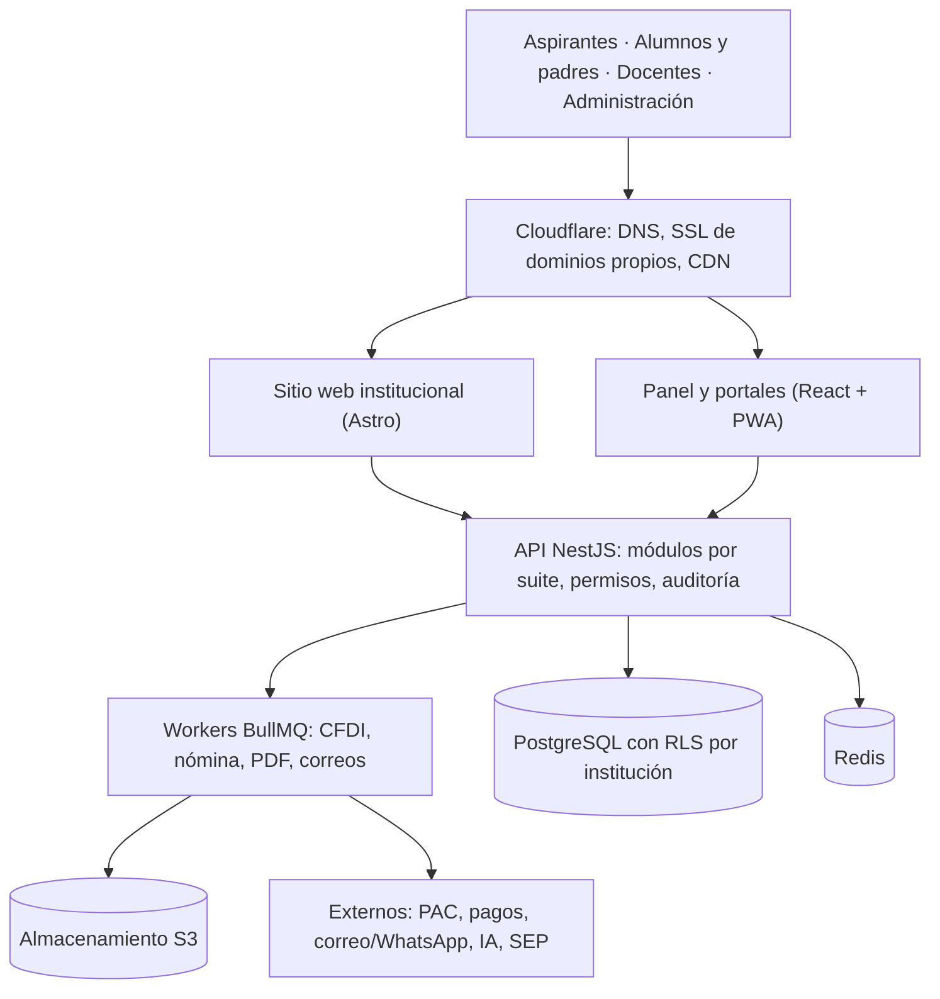
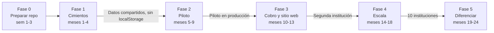

# CampusOne — Propuesta de producto SaaS para instituciones educativas

Versión: 9 de noviembre de 2026

> Documento vivo: la versión editable está en [CampusOne — Propuesta](https://claude.ai/artifact/T2wM6Y3YcmBcXE2ZF3qcNZ). Esta copia en el repositorio es la referencia de trabajo; actualízala cuando cambie el plan.

## Resumen ejecutivo

CampusOne puede convertirse en una **plataforma SaaS de gestión integral para bachilleratos y universidades mexicanas**, pero hoy es un prototipo de frontend: todo vive en el navegador y no hay seguridad real. Antes de vender hacen falta backend, base de datos multi-institución y los procesos que exige la ley mexicana (CFDI, nómina, título y certificado electrónicos, datos personales).

La ventaja frente a la competencia es juntar en un solo sistema, sencillo y con la marca de cada escuela, lo que hoy está repartido en 4 o 5 herramientas: sitio web, admisiones, control escolar, cobranza con factura, nómina y portales para alumnos, padres y docentes.

### Las cinco decisiones clave

1. **Una plataforma, muchas instituciones**: una sola base PostgreSQL con aislamiento por institución (Row Level Security) y despliegue dedicado solo como plan superior.
2. **Stack en TypeScript de punta a punta**: React (lo actual) + NestJS + PostgreSQL + Redis, en un monorepo que comparte reglas entre web y API.
3. **Configurar, no programar**: todo lo que varía entre escuelas (reglas, documentos, flujos, marca, módulos) es configuración con plantillas por tipo de institución.
4. **Cumplimiento mexicano como argumento de venta**: CFDI con IEDU, nómina 1.2, título electrónico, certificado de bachillerato, formato 911 y nueva LFPDPPP.
5. **Hosting compartido en VPS con Cloudflare al frente**, con opción de datos en México (regiones de Querétaro) para quien lo exija.

Primer paso concreto: dedicar las fases 0 y 1 (unos 4 meses, tú con Claude Code) a backend, identidad y base de datos, sin agregar pantallas nuevas, y cerrar un piloto pagado en una escuela.

## Diagnóstico del proyecto actual

CampusOne ya tiene un recorrido de producto muy completo (unas 25 pantallas y 4 portales), pero es un **prototipo de frontend**: no hay base de datos, ni identidad real, ni separación por institución. Lo que más valor tiene hoy es el modelo de dominio de Control escolar y la experiencia de los portales. Lo que más riesgo tiene es que todo vive en el navegador.

### Qué funciona y conviene conservar

- **Modelo académico de Control escolar**: carrera → plan → materia → grupo → inscripción → kárdex, con bloqueos, bajas, revalidaciones y movimientos con historial. Es la columna vertebral del producto.
- **Login único con redirección por rol** (institución, administración, docente, alumno).
- **Portal público de admisiones** con registro, folio y seguimiento.
- **Personalización institucional** por JSON (nombre, colores, reglas de calificación). Es el germen del multi-institución.
- **Generador de horarios por restricciones** (local) con IA opcional del lado del servidor. Es un diferenciador real.
- **Pruebas de reglas de negocio** (`test:school`, `test:directory`, `test:operations`) y el nuevo estándar visual en `DESIGN.md`.

### Qué está roto o es solo demostración

| Área | Situación hoy | Riesgo para vender |
| --- | --- | --- |
| Persistencia | `localStorage` e IndexedDB por navegador (`campusone-school-v1`, `campusone-operations-v1`) | Dos usuarios nunca ven los mismos datos |
| Autenticación | Rol guardado en `sessionStorage`; contraseña única `universidad` | Cualquiera puede hacerse administrador desde la consola |
| Permisos | Validados solo en el frontend | No hay seguridad real |
| Portales alumno y docente | Datos de ejemplo fijos, no conectados al directorio | El alumno no ve su kárdex real |
| Finanzas y becas | Cargos y catálogos de demostración | No cobra ni factura |
| Indicadores del Resumen | Números fijos | Pierde credibilidad en una demo |
| Documentos | Imprimibles sin firma, sello ni folio verificable | No tienen validez oficial |

### Deuda técnica que frena crecer

- **Ruteo manual**: `App.tsx` decide la pantalla con 14 comparaciones `pathname ===` en lugar de rutas declaradas de React Router. Dificulta permisos por ruta, carga diferida y enlaces profundos.
- **Código comprimido**: 141 líneas de más de 400 caracteres en componentes, y CSS minificado a mano (`student.css`, `teacher.css`). Es difícil de revisar y de mantener en equipo.
- **Dependencias en `latest`**: React, Vite y React Router sin versión fija. Una instalación nueva puede romper el build sin ningún cambio de código.
- **Paquete único de 736 kB**: todo se descarga al entrar, incluido el portal docente para un aspirante.
- **Mezcla de nombres**: `nexo-*` y `campusone-*` en claves, `--brand-violet` que hoy es azul. Conviene unificar antes de tener clientes.
- **Sin capa de datos**: cada módulo lee y escribe su almacenamiento directamente. Al migrar a API habrá que tocar todas las pantallas si no se introduce una capa de servicios.

### Qué sobra o conviene replantear

- **`gsap` + `ScrollTrigger`** solo para `FadeContent`: unos 70 kB por un desvanecido. Se sustituye con CSS.
- **Tres logins visuales distintos** (general, alumno, docente) cuando ya existe acceso único. Debe quedar uno, con la marca de la institución.
- **Tres hojas de tema superpuestas** (`theme.css`, `design-system.css`, `paper-theme.css`). Ahora que existe `DESIGN.md`, se consolidan en una sola capa de tokens.
- **OpenAI atado al proveedor**: la generación de horarios debe quedar detrás de una interfaz, con el solucionador local como opción principal y la IA como asistente.
- **Residencias y Titulación como módulos fijos**: solo aplican a superior (y con reglas TecNM). Deben ser módulos activables por tipo de institución, no parte del núcleo.

## Procesos escolares en México que el sistema debe cubrir

Para venderse en México, CampusOne tiene que cubrir tres frentes legales que hoy no toca: **documentos electrónicos de la SEP**, **facturación y nómina ante el SAT** y **protección de datos personales**. Son la razón principal por la que una escuela cambia de sistema, y el mejor argumento de venta.

### Ciclo de vida del alumno (común a media superior y superior)

1. **Promoción y captación**: sitio web, ferias, prospectos (CRM), visitas guiadas.
2. **Admisión**: convocatoria, registro con CURP, pago de ficha, examen (propio o externo, p. ej. EXANI de Ceneval), resultados, curso propedeútico.
3. **Inscripción**: entrega y cotejo de documentos (acta de nacimiento, CURP, certificado del nivel anterior), asignación de matrícula, contrato de servicios y aviso de privacidad.
4. **Trayectoria**: reinscripción por periodo, carga académica, horarios, evaluaciones parciales y finales, extraordinarios, asistencia, tutorías, becas, bajas y reingresos, equivalencias y revalidaciones.
5. **Requisitos de egreso**: servicio social (en licenciatura, 480 horas como referencia general), prácticas o residencias, idioma, créditos complementarios, no adeudos.
6. **Certificación y titulación**: certificado de estudios, acta de examen o exención, título electrónico y registro ante la DGP para la cédula.
7. **Egresados**: seguimiento, bolsa de trabajo, encuestas de empleabilidad, educación continua.

### Diferencias por nivel

| Tema | Media superior (bachillerato) | Superior (licenciatura y posgrado) |
| --- | --- | --- |
| Marco curricular | Marco Curricular Común (MCCEMS), con normas de control escolar de cada subsistema (DGB, DGETI, DGETA, CECyTE, incorporadas) | Planes propios autorizados por RVOE (SEP o estado) o por autonomía |
| Periodos | Semestres, ciclo escolar agosto–julio | Semestres, cuatrimestres o trimestres; modalidades escolarizada, mixta y en línea |
| Evaluación | Parciales, promedios por semestre, recuperación y extraordinarios | Créditos, seriación, extraordinarios, oportunidades limitadas |
| Documento final | Certificado electrónico SEP con QR, consultable en SIGED: terminación, formación profesional y parcial | Certificado de estudios y título electrónico XML firmado, registrado ante la DGP |
| Padres o tutores | Indispensables: avisos, boletas, autorización de salidas, pagos | Opcionales |
| Requisitos extra | Servicio social del bachillerato (según subsistema), orientación educativa, prevención de abandono | Servicio social, residencias o prácticas, titulación, idioma |
| Facturación | CFDI con complemento IEDU (deducible) | CFDI con complemento IEDU solo hasta profesional técnico; licenciatura sin complemento de deducción |

### Obligaciones oficiales que el sistema debe automatizar

| Obligación | Qué pide | Qué debe hacer CampusOne |
| --- | --- | --- |
| Certificado electrónico de bachillerato | Formatos SEP con folio y QR, validables en SIGED; aplican a generaciones del MCCEMS | Generar los datos del certificado desde el kárdex y exportarlos en el formato del subsistema |
| Título electrónico | XML firmado con e.firma (FIEL) de los responsables de la institución, enviado a la DGP; obligatorio desde octubre de 2018 | Armar el XML, firmarlo con la e.firma del rector y del responsable de control escolar, y llevar el estado del registro |
| RVOE | Clave por plan y nivel; vigente y visible en documentos y facturas | Catálogo de RVOE por programa con fechas y alertas de vencimiento |
| Estadística 911 | Cuestionarios SEP de inicio y fin de ciclo | Reporte prellenado con matrícula por sexo, edad, grado y egreso |
| CFDI 4.0 de colegiaturas | Complemento IEDU con nombre, CURP, nivel educativo del alumno y clave del RVOE; uso D10 | Facturación automática por pago con datos del alumno ya capturados |
| CFDI de nómina | Complemento de nómina 1.2, revisión E vigente desde el 1 de enero de 2026 | Timbrado de nómina por pago, asimilados incluidos |
| Seguridad social | Altas, bajas y modificaciones ante el IMSS (IDSE), cálculo de cuotas (SUA) e INFONAVIT | Exportar movimientos afiliatorios y cálculos para IDSE/SUA |
| Datos personales | Nueva LFPDPPP publicada el 20 de marzo de 2025; la Secretaría Anticorrupción y Buen Gobierno sustituye al INAI | Aviso de privacidad por institución, consentimiento, derechos ARCO, bitácora de accesos y datos sensibles (salud, discapacidad) cifrados |

Antes de construir cada obligación hay que validar la versión vigente con la fuente oficial (DGAIR, DGP y SAT) y con un contador o abogado. Las reglas cambian cada año y difieren entre subsistemas y estados.

### Procesos administrativos del instituto

- **Finanzas**: listas de precios por plan y periodo, cargos recurrentes, recargos, descuentos, becas, convenios de pago, pagos en línea (tarjeta, SPEI, OXXO) y conciliación bancaria.
- **Recursos humanos**: expediente del personal, contratos, plazas docentes por horas, asistencia y checador, incidencias, vacaciones y evaluación docente.
- **Operación**: aulas y laboratorios, inventario, biblioteca, compras, mantenimiento, transporte y cafetería.
- **Calidad y acreditación**: evidencias para COPAES, CIEES o FIMPES, indicadores de deserción, reprobación y eficiencia terminal.

Fuentes consultadas: [certificados electrónicos de bachillerato (El Universal)](https://www.eluniversal.com.mx/nacion/asi-sera-el-nuevo-certificado-digital-de-conclusion-de-bachillerato-estudiantes-del-ciclo-2024-2025-los-primeros-en-recibirlo/), [normas de control escolar MCCEMS (DGAIR)](https://dgair.sep.gob.mx/storage/recursos/CE/ems_dc/2025_2026/mcc_bcymccems_nem_cte.pdf), [título electrónico SEP (Mextudia)](https://mextudia.com/titulo-electronico-sep/?amp=1), [complemento IEDU (SAT)](https://www.sat.gob.mx/sitio_internet/cfd/iedu/iedu.pdf), [complemento IEDU (Alegra)](https://blog.alegra.com/mexico/complemento-iedu/), [nómina 1.2 revisión E (KPMG)](https://kpmg.com/mx/es/tendencias/2025/12/flash-sat-cfdi-de-nomina-2026-version-1-2-del-complemento.html), [nueva LFPDPPP (Garrigues)](https://www.garrigues.com/es_ES/noticia/mexico-nueva-ley-federal-proteccion-datos-personales-posesion-particulares-introduce) y [funciones del INAI en la Secretaría Anticorrupción (IDC)](https://idconline.mx/corporativo/2025/04/02/que-asumio-la-secretaria-anticorrupcion-tras-la-desaparicion-del-inai).

## Competencia y cómo diferenciarse

El mercado está partido en dos: **ERPs globales caros y complejos** para universidades grandes, y **sistemas mexicanos sencillos** que cubren control escolar y cobranza pero no SEP electrónico, nómina ni sitio web. El hueco para CampusOne es la escuela mediana de 300 a 8,000 alumnos que quiere todo en un solo lugar, en español y con cumplimiento mexicano.

| Sistema | Tipo | Fuerte en | Débil para una escuela mexicana mediana |
| --- | --- | --- | --- |
| Ellucian Banner / Colleague | ERP universitario global | Procesos completos de universidades grandes | Implementación de meses, costo alto, adaptación a SEP y SAT por consultoría |
| PowerSchool | SIS K-12 | Escuelas básicas y padres | Pensado para EUA; poco de superior y de normativa mexicana |
| [Classter](https://www.comparasoftware.com/administracion-escolar?page=2) / Classe365 | SaaS integral (SIS, LMS, ERP, CRM) | Amplitud de módulos | Genéricos internacionales; sin CFDI, título electrónico ni 911 |
| [Servoescolar](https://www.capterra.com/p/241784/Servoescolar/alternatives/) | SaaS mexicano | Control escolar, pagos en línea | Orientado a escuelas pequeñas (perfiles de 2 a 200 usuarios) |
| [Saeko](https://www.comparasoftware.com/administracion-escolar) y otros sistemas locales | Software mexicano de control escolar | Conocen la normativa local | Interfaces anticuadas, poca personalización, portales limitados |
| Odoo (módulos educativos) | ERP abierto | Contabilidad, RH, inventario | Lo académico es de terceros; requiere integrador |
| Moodle, Google Classroom, Canvas | LMS | Clases y tareas en línea | No son control escolar; se integran, no compiten |
| Desarrollos propios (p. ej. SII en Tecnológicos) | Sistemas internos | Ajustados a su institución | Caros de mantener; oportunidad de reemplazo |

Nota: las descripciones de Ellucian, PowerSchool, Odoo y los LMS vienen de conocimiento general del mercado, no de fuentes abiertas para este documento. Conviene validarlas con demos antes de usarlas en material de venta.

### Propuesta de valor de CampusOne

1. **Cumplimiento mexicano incluido**: CFDI con IEDU, nómina 1.2, título electrónico, certificado de bachillerato, 911 y aviso de privacidad, sin consultoría extra.
2. **Todo en uno**: sitio web, admisiones, control escolar, cobranza, facturación, nómina y portales, con un solo usuario por persona.
3. **Lista en días, no meses**: plantillas por tipo de institución (bachillerato general, tecnológico, universidad privada, posgrado) e importación desde Excel.
4. **Sencillo de usar**: interfaz limpia (`DESIGN.md`), móvil primero para alumnos, padres y docentes.
5. **Su marca, no la nuestra**: dominio, logo, colores y sitio web propios de cada institución.
6. **Asistente inteligente**: horarios automáticos, alertas de riesgo de abandono y respuestas a dudas frecuentes de alumnos.

## Mapa de módulos propuesto

La propuesta organiza CampusOne en **un núcleo obligatorio y 11 suites activables**. Cada institución prende solo lo que usa y paga por suite. Las marcas indican el estado actual: **Existe** (hay pantalla, falta backend), **Parcial** y **Nuevo**.

### 0. Núcleo de plataforma (siempre incluido)

| Módulo | Qué incluye | Estado |
| --- | --- | --- |
| Institución y campus | Datos fiscales, RVOE por programa, campus, niveles, ciclos y calendario oficial | Parcial |
| Identidad y accesos | Login único, SSO con Google/Microsoft, 2FA, recuperación por correo y SMS, sesiones | Parcial (demo) |
| Roles y permisos | Roles por plantilla y personalizados, permisos por campus y programa | Parcial (solo frontend) |
| Personas | Una ficha por persona con varios roles (alumno, padre, docente, empleado, egresado) | Nuevo |
| Catálogos | Países, estados, municipios, escuelas de procedencia, motivos de baja, documentos | Parcial |
| Auditoría | Bitácora de quién cambió qué y cuándo, exportable | Nuevo |
| Notificaciones | Correo, push, WhatsApp y SMS con plantillas | Nuevo |
| Archivos | Almacenamiento seguro de documentos con versiones y visor | Parcial (local) |
| Importación | Carga masiva desde Excel con validación y vista previa | Nuevo |

### 1. Sitio web institucional (constructor)

- Página principal con plantillas por tipo de institución, editor por bloques (héroe, oferta académica, noticias, eventos, galería, testimonios, contacto, mapa).
- **Oferta académica conectada**: los programas, RVOE, costos y fechas salen del sistema, no se capturan dos veces.
- Blog y noticias, calendario de eventos público, preguntas frecuentes.
- Formularios que crean prospectos en el CRM.
- Dominio propio (`www.instituto.edu.mx`) con certificado SSL automático, SEO y estadísticas de visitas.
- Aviso de privacidad, transparencia y reglamentos publicados desde el sistema.

### 2. Atracción y admisiones

| Módulo | Qué incluye | Estado |
| --- | --- | --- |
| CRM de prospectos | Embudo por campaña, seguimiento por asesor, WhatsApp, recordatorios, conversión | Nuevo |
| Convocatorias | Fechas, cupos por programa, requisitos, costo de ficha | Existe |
| Registro de aspirantes | Validación de CURP con RENAPO, documentos, folio | Existe |
| Examen de admisión | Banco de reactivos, examen en línea con tiempo, calificación automática, carga de resultados externos | Parcial (constructor) |
| Resultados y propedeútico | Listas de aceptados, curso de inducción, conversión automática a alumno | Nuevo |

### 3. Control escolar

| Módulo | Qué incluye | Estado |
| --- | --- | --- |
| Oferta académica | Programas, planes versionados, materias, créditos, seriación, equivalencias | Existe |
| Inscripción y reinscripción | En línea por el alumno con validación de adeudos y seriación | Parcial |
| Grupos y horarios | Generador automático por restricciones, aulas con capacidad y equipo | Existe |
| Evaluación | Parciales, ponderaciones configurables, extraordinarios, actas firmadas, cierre de periodo | Parcial |
| Asistencia | Por clase, QR o lista, alertas de faltas | Parcial |
| Kárdex y trayectoria | Historial, promedios, avance de créditos, riesgo académico | Existe |
| Movimientos | Bajas, reingresos, cambios de carrera, revalidaciones, bloqueos | Existe |
| Documentos oficiales | Constancias con QR verificable, boletas, certificado de bachillerato, certificado y título electrónico XML para DGP | Parcial (imprimibles demo) |
| Estadística oficial | Formato 911 prellenado, indicadores de deserción y eficiencia terminal | Nuevo |

### 4. Vida académica y egreso

- **Servicio social**: dependencias, convocatorias, horas, reportes bimestrales, carta de liberación. *Nuevo.*
- **Prácticas y residencias**: empresas, convenios, asesores, evidencias. *Existe.*
- **Titulación**: modalidades, requisitos, sinodales, acta de examen y título electrónico. *Existe.*
- **Idiomas y créditos complementarios**: niveles, acreditación, actividades culturales y deportivas. *Existe (inglés).*
- **Tutorías y orientación**: tutor asignado, bitácora de sesiones, canalización a psicología. *Nuevo.*
- **Egresados**: directorio, encuestas, bolsa de trabajo, constancias para posgrado. *Nuevo.*

### 5. Finanzas y facturación

| Módulo | Qué incluye | Estado |
| --- | --- | --- |
| Planes de pago | Colegiaturas, inscripciones, cuotas por programa, campus y generación | Parcial |
| Cargos y recargos | Generación mensual automática, recargos y descuentos por pronto pago | Parcial |
| Pagos en línea | Tarjeta, SPEI con referencia, OXXO, domiciliación (Stripe, Openpay, Conekta, Mercado Pago) | Nuevo |
| Facturación CFDI 4.0 | Timbrado automático por pago con IEDU, notas de crédito, cancelación, factura global | Nuevo |
| Becas y convenios | Solicitud, comité, aplicación automática al cargo, renovación por promedio | Parcial |
| Cobranza | Estados de cuenta, recordatorios por WhatsApp, convenios, bloqueo automático por adeudo | Parcial |
| Conciliación y tesorería | Lectura de estados bancarios, cortes de caja, póliza contable exportable | Nuevo |
| Punto de venta | Caja para uniformes, libros, credenciales y cafetería | Nuevo |

### 6. Recursos humanos y nómina

- **Expediente del personal**: contratos, plazas, grados, documentos, cursos.
- **Docentes por hora**: horas frente a grupo calculadas desde los horarios asignados.
- **Asistencia del personal**: checador con QR o geolocalización, incidencias, permisos y vacaciones.
- **Nómina**: cálculo de ISR, IMSS e INFONAVIT, asimilados y honorarios, timbrado CFDI de nómina 1.2, recibos en portal, dispersión bancaria.
- **IMSS**: archivos para IDSE (altas, bajas, modificaciones) y SUA.
- **Evaluación docente**: encuesta de alumnos, autoevaluación y resultados por periodo.

Todo este bloque es *Nuevo*, salvo el directorio docente que ya existe.

### 7. Portales y comunicación

| Portal | Qué debe ofrecer | Estado |
| --- | --- | --- |
| Alumno (web y app) | Horario, calificaciones, kárdex, pagos y facturas, trámites, credencial digital, avisos | Parcial (demo) |
| Padres o tutores | Hijos vinculados, calificaciones, asistencia, pagos, avisos, autorizaciones | Nuevo |
| Docente | Grupos, listas, calificaciones, actas, planeación, recibos de nómina | Parcial (demo) |
| Empleado | Recibos, vacaciones, incidencias, documentos | Nuevo |
| Mensajería y avisos | Comunicados segmentados por grupo, nivel o rol con confirmación de lectura | Parcial |
| Trámites en línea | Constancias, credenciales, reposiciones, pago y entrega digital | Parcial |

### 8. Operación del campus

- Aulas, laboratorios y reservas de espacios.
- Biblioteca: catálogo, préstamos, multas conectadas a finanzas.
- Inventario y activos fijos, compras y proveedores.
- Control de acceso con credencial QR, enfermería, transporte y cafetería.

### 9. Aprendizaje en línea

- Integración con Moodle, Google Classroom y Microsoft Teams (alta de cursos y alumnos automática, regreso de calificaciones).
- Aula básica propia para instituciones pequeñas: materiales, tareas y foros.

### 10. Calidad, reportes e inteligencia

- Tableros por rol: rectoría, dirección académica, finanzas, coordinación.
- Indicadores de acreditación (COPAES, CIEES, FIMPES): deserción, reprobación, eficiencia terminal, empleabilidad.
- Alertas tempranas de abandono: faltas, reprobación y adeudos combinados.
- Constructor de reportes y exportación a Excel y PDF.

### 11. Asistente con IA

- Generación de horarios (ya existe en local).
- Chat de dudas frecuentes para aspirantes y alumnos con base en los reglamentos de la institución.
- Redacción de comunicados, resúmenes de expedientes y detección de documentos ilegibles.
- Siempre detrás de permisos y sin enviar datos sensibles al proveedor.

## Personalización por institución

La regla es **configurar, no programar**: todo lo que cambia entre escuelas vive como datos de configuración por institución, nunca como código especial para un cliente. Un solo código sirve a todas las instituciones, y un cliente nuevo se da de alta con un asistente de 7 pasos.

### Qué se configura

| Capa | Ejemplos | Dónde se guarda |
| --- | --- | --- |
| Marca | Logo, colores (los tokens de `DESIGN.md`), tipografía, dominio, correo remitente | Tabla `institution_settings` |
| Estructura | Campus, niveles, modalidades, periodos (semestre, cuatrimestre), turnos | Catálogos por institución |
| Reglas académicas | Escala de calificación, mínimo aprobatorio, decimales, número de parciales y ponderaciones, extraordinarios permitidos, faltas máximas | Reglas por nivel y programa |
| Documentos | Plantillas de constancia, boleta, credencial y kardex con firmas y sellos | Plantillas editables (el `ReportDesigner` actual es la base) |
| Flujos | Pasos de admisión, requisitos de titulación, aprobaciones de becas | Flujos configurables con estados y responsables |
| Finanzas | Conceptos, precios, recargos, descuentos, datos fiscales y certificados de sello digital (CSD) | Configuración fiscal cifrada |
| Campos extra | Datos propios de cada escuela (tipo de sangre, religión, talla de uniforme) | Campos personalizados por entidad |
| Módulos | Qué suites están activas y qué menús ve cada rol | Banderas por institución y plan |
| Idioma y textos | Llamar "carrera" o "programa", "semestre" o "grado" | Diccionario de etiquetas por institución |

### Plantillas por tipo de institución

Cada plantilla precarga catálogos, reglas, documentos y menús para empezar en un día:

- **Bachillerato general** (DGB o incorporado): grados y grupos, parciales, MCCEMS, portal de padres.
- **Bachillerato tecnológico** (DGETI, CECyTE): módulos profesionales, prácticas y certificado de formación profesional.
- **Universidad privada con RVOE**: créditos, cuatrimestres, servicio social, titulación y título electrónico.
- **Tecnológico o universidad pública**: residencias, créditos complementarios, inglés y academias (lo que ya existe).
- **Posgrado y educación continua**: generaciones, seminarios, cursos cortos y diplomados con pago por curso.

### Asistente de alta de una institución

1. Datos generales, fiscales y RVOE.
2. Marca: logo, colores y dominio, con vista previa en vivo.
3. Plantilla de nivel y programas.
4. Reglas de evaluación y calendario.
5. Importación de alumnos, docentes y adeudos desde Excel.
6. Configuración de cobro y facturación (CSD, pasarela).
7. Invitación a usuarios y publicación del sitio web.

## Reestructuración técnica

Recomendación: **mantener React + TypeScript en el frontend, construir la API en Node.js con NestJS y usar PostgreSQL como base de datos única multi-institución**. Todo el stack queda en TypeScript, así que las reglas que hoy tienen pruebas (`school.ts`, `operations.ts`) se mueven al servidor casi sin reescribirse.

### Stack recomendado

| Capa | Elección | Por qué | Alternativa |
| --- | --- | --- | --- |
| Repositorio | Monorepo con pnpm y Turborepo | Comparte tipos, validaciones y componentes entre web, API y sitio | Repos separados |
| Panel y portales | React 19 + Vite + React Router (rutas declaradas) + TanStack Query | Ya está hecho en React; TanStack Query reemplaza el `localStorage` con caché de servidor | — |
| Sitio web institucional | Astro (o Next.js) renderizando por dominio | SEO y velocidad para la página pública; lee el contenido del constructor | Next.js si se quiere todo en React |
| App móvil | PWA primero; React Native/Expo después | El portal ya es adaptable; la PWA permite notificaciones push sin tiendas | — |
| API | NestJS (Node 24) con módulos por suite | Estructura clara por dominio, inyección de dependencias, guardas de permisos | Fastify puro si el equipo es pequeño |
| Validación | Zod en un paquete compartido | Las mismas reglas en el formulario y en el servidor | — |
| Base de datos | PostgreSQL 17 | Relacional (el dominio escolar lo es), JSONB para campos personalizados, Row Level Security para aislar instituciones | MySQL |
| ORM y migraciones | Drizzle ORM (o Prisma) | Tipado completo y migraciones versionadas | Kysely |
| Trabajos en segundo plano | Redis + BullMQ | Timbrado CFDI, nómina, correos, generación de PDF y horarios sin bloquear la API | — |
| Archivos | Almacenamiento compatible con S3 (Cloudflare R2, Backblaze B2 o MinIO) | Barato, sin costo de salida en R2, cifrado | Disco del servidor (no escala) |
| Identidad | Better Auth o Keycloak con OIDC (Google, Microsoft) y 2FA | SSO con las cuentas institucionales que ya tienen las escuelas | Auth0 (caro por usuario) |
| PDF y documentos | Plantillas HTML a PDF con Playwright/Chromium en un worker | Reutiliza el diseño web para constancias y boletas | — |
| Timbrado CFDI | Un PAC por API (p. ej. Facturama, SW Sapien, Finkok) | El PAC timbra; nosotros armamos el XML con IEDU y nómina | — |
| Pagos | Stripe, Openpay, Conekta o Mercado Pago con webhooks | Tarjeta, SPEI y OXXO, conciliados automáticamente | — |
| Observabilidad | Sentry, logs estructurados, métricas con Grafana | Saber qué falla antes de que llame el cliente | — |

Los proveedores de PAC y pagos se mencionan como ejemplos del mercado mexicano; hay que comparar precio por timbre y comisiones antes de elegir.

Todas las peticiones pasan por la API, que fija la institución por el dominio y la sesión; lo lento (timbrado, nómina, PDF) va a los workers.

### Base de datos: un esquema, muchas instituciones

- **Modelo compartido con `institution_id` en cada tabla y Row Level Security de PostgreSQL**. La base rechaza cualquier consulta que intente leer datos de otra institución, aunque el código tenga un error. Es la opción más barata de operar con cientos de escuelas.
- **Base dedicada para clientes grandes** que lo exijan por contrato. El mismo código se conecta a una base distinta según la institución.
- **Entidades principales**: `institution`, `campus`, `person` (una sola ficha con roles), `student`, `guardian`, `employee`, `program`, `plan_version`, `subject`, `term`, `group`, `enrollment`, `grade`, `attendance`, `charge`, `payment`, `invoice`, `payroll_run`, `document`, `audit_log`.
- **Planes versionados**: cada alumno queda ligado a la versión del plan con la que ingresó; hoy la oferta solo guarda la vigente.
- **Auditoría en la base**: un registro por cada cambio en calificaciones, pagos y movimientos, con usuario, fecha y valor anterior.
- **Datos sensibles cifrados**: CURP, salud, discapacidad y datos bancarios cifrados a nivel de columna.

### Cambios en el frontend actual

1. Fijar versiones de dependencias y quitar `latest` del `package.json`.
2. Pasar el ruteo de `App.tsx` a rutas declaradas con carga diferida por portal; el paquete de 736 kB se divide por rol.
3. Crear una capa `services/` con un cliente de API; las pantallas dejan de leer `localStorage` directamente. Primero con un adaptador local (lo actual), después con la API, sin tocar las pantallas dos veces.
4. Mover las reglas de `school.ts`, `operations.ts` y `admissions.ts` a `packages/domain` para usarlas en web y API.
5. Formatear el código (Prettier y ESLint) y desminificar el CSS; consolidar `theme.css`, `design-system.css` y `paper-theme.css` en una capa de tokens.
6. Agregar pruebas de interfaz con Playwright para los flujos de venta: admisión, inscripción, pago y calificación.
7. Unificar nombres (`campusone-*`) y renombrar variables CSS por rol (`--color-primary` en lugar de `--brand-violet`).

## Infraestructura y hosting por institución

Recomendación: **no montar un VPS por institución desde el inicio**. Una sola plataforma compartida, con cada escuela aislada en la base de datos y con su propio dominio, cuesta una fracción y se actualiza una sola vez. El servidor dedicado se ofrece como plan superior para quien lo pida por contrato.

### Tres modalidades de despliegue

| Modalidad | Para quién | Cómo funciona | Costo de infraestructura aproximado |
| --- | --- | --- | --- |
| Compartida (por defecto) | Escuelas de hasta unos 5,000 alumnos | Mismo clúster, datos aislados con Row Level Security, dominio propio por institución | 100 a 250 USD al mes para las primeras 20 a 50 instituciones en total |
| Dedicada | Universidades grandes o que exigen aislamiento | VPS o base propia por institución, mismo código, desplegado automáticamente | 40 a 120 USD al mes por institución |
| Datos en México | Instituciones públicas o con requisito de residencia | Despliegue dedicado en una región de Querétaro | 1.5 a 3 veces el costo de un VPS equivalente |

Los costos son estimaciones de mercado sin cotización; hay que validarlos con los precios vigentes de cada proveedor.

### Dónde hostear

| Proveedor | Ventaja | Cuándo usarlo |
| --- | --- | --- |
| Hetzner Cloud (centros de datos en EUA y Europa) | El mejor precio por CPU y memoria | Plataforma compartida y despliegues dedicados económicos |
| DigitalOcean o Vultr | Bases de datos y Redis administrados, simple de operar | Si el equipo no quiere administrar PostgreSQL |
| [AWS México (mx-central-1)](https://mexicoindustry.com/noticia/centros-de-datos-en-mexico-donde-estan-y-por-que-estan-creciendo), [Azure Mexico Central](https://www.azurespeed.com/Information/AzureRegions/MexicoCentral) o [Google Cloud northamerica-south1](https://datacenterdynamics.com/en/news/google-launches-mexican-cloud-region-in-queretaro) | Regiones en Querétaro con tres zonas de disponibilidad | Clientes que exigen datos en territorio mexicano |
| Cloudflare | DNS, SSL automático para dominios de clientes, protección DDoS, almacenamiento R2 | Siempre, delante de la plataforma |

### Cómo se despliega

- **Contenedores Docker** para web, API, workers y sitio; un mismo artefacto para compartido y dedicado.
- **Coolify o Kamal** sobre VPS para empezar (sin Kubernetes). Pasar a Kubernetes solo con decenas de despliegues dedicados.
- **Terraform y Ansible** para crear un despliegue dedicado nuevo con un comando.
- **CI/CD con GitHub Actions**: pruebas, build, migraciones y despliegue por etapas (staging → producción).
- **Dominios de clientes** con Cloudflare for SaaS (hostnames personalizados): la escuela apunta un CNAME y obtiene SSL automático.

### Respaldos, seguridad y continuidad

- Respaldo continuo de PostgreSQL (pgBackRest o WAL-G) a almacenamiento S3 en otra región; recuperación a cualquier minuto de los últimos 30 días.
- Prueba de restauración mensual documentada.
- Cifrado en tránsito (TLS) y en reposo; llaves de CSD y e.firma en un almacén de secretos, nunca en la base en claro.
- 2FA obligatorio para administradores, límite de intentos y bitácora de accesos.
- Exportación completa de datos de la institución al terminar el contrato.

### Cumplimiento de datos personales

La [nueva LFPDPPP](https://www.garrigues.com/es_ES/noticia/mexico-nueva-ley-federal-proteccion-datos-personales-posesion-particulares-introduce) (vigente desde el 21 de marzo de 2025) aplica a escuelas particulares y a CampusOne como encargado del tratamiento. Hacen falta un contrato de encargo con cada institución, un aviso de privacidad por escuela, atención de derechos ARCO, aviso de transferencias si los datos se alojan fuera de México y protocolo de vulneraciones. Las instituciones públicas se rigen por la ley general para sujetos obligados y suelen pedir datos en México. Conviene validar este punto con un abogado de protección de datos.

## Modelo comercial

Propuesta: **suscripción anual por alumno activo, con tres planes y una cuota de implementación**. Cobrar por alumno escala con el tamaño de la escuela y es fácil de explicar a un director. Los precios son una propuesta inicial para validar con 5 a 10 escuelas piloto, no precios de mercado investigados.

| Plan | Incluye | Precio propuesto (MXN por alumno al mes, anual) | Mínimo mensual |
| --- | --- | --- | --- |
| Esencial | Núcleo, sitio web, admisiones, control escolar, portales de alumno, padres y docente | 25 a 35 | 3,500 |
| Profesional | Esencial + finanzas, pagos en línea, facturación CFDI, becas, documentos con QR, reportes | 45 a 60 | 7,000 |
| Institucional | Profesional + RH y nómina, título electrónico, tablero de calidad, IA, despliegue dedicado opcional | 70 a 95 | 15,000 |

### Ingresos adicionales

- **Implementación y migración**: cuota única de 15,000 a 80,000 MXN según tamaño y calidad de los datos de origen.
- **Timbres CFDI**: paquetes con margen sobre el costo del PAC.
- **Comisión de pagos en línea**: margen pequeño por transacción con la pasarela (o la escuela usa su propia cuenta).
- **Capacitación y soporte premium**: horas de consultoría, soporte con tiempo de respuesta garantizado.
- **Desarrollos a la medida**: solo si se vuelven configuración reutilizable para todos los clientes.

### Cómo vender

1. **Piloto pagado en una escuela conocida** (por ejemplo, la institución propia) durante un semestre, para obtener un caso de éxito con números: tiempo de inscripción, cobranza recuperada y trámites en línea.
2. **Demo con datos ficticios realistas** por tipo de institución, lista para mostrar en 15 minutos.
3. **Venta a direcciones y dueños**: el argumento es cobranza y cumplimiento (CFDI, títulos, 911), no tecnología.
4. **Canales**: asociaciones de escuelas particulares estatales, ferias educativas, contadores que atienden escuelas, integradores regionales con comisión.
5. **Contrato**: anual con renovación automática, acuerdo de nivel de servicio (99.5% de disponibilidad) y contrato de encargo de datos.

## Roadmap por fases

El orden propuesto prioriza lo que hace vendible el producto: **primero datos reales y seguridad, luego un piloto, después cobro y facturación**. No se pasa a la siguiente fase sin cumplir su puerta (los rombos). Los plazos suponen una sola persona trabajando con Claude Code, en sprints de 3 semanas, y son una estimación inicial.

La fase 1 no agrega pantallas: reemplaza el `localStorage` por la API sin cambiar lo que ve el usuario. Las metas de las puertas 3 y 4 son objetivos comerciales propuestos, no compromisos.

El detalle sprint por sprint, con lo que se hace con el código actual, está en Plan de implementación.

## Skills y herramientas de Claude que ayudan a construirlo

Ya tienes activas la mayoría de las skills útiles; la de mayor impacto sería una **skill propia de CampusOne** que no existe todavía. Las búsquedas en tu catálogo no encontraron skills de facturación, SEP ni educación.

### Ya disponibles en tu cuenta

| Skill | Para qué la usarías en CampusOne |
| --- | --- |
| `website-design:landing-page` y `website-design:web-design-system` | Diseñar las plantillas del sitio web institucional por tipo de escuela |
| `frontend-design:frontend-design` | Pantallas nuevas (portal de padres, nómina) con criterio visual propio |
| `design-skills:accessibility-audit` y `design:accessibility-review` | Auditoría WCAG antes de vender a instituciones públicas |
| `design-skills:ux-writing` y `design:ux-copy` | Textos de formularios, errores y avisos en español claro |
| `design-skills:journey-mapping` | Mapas del recorrido de aspirante, alumno y padre para el material de venta |
| `design-skills:ux-research` y `design:user-research` | Guiones de entrevista para las escuelas piloto |
| `code-review`, `security-review` y `simplify` | Revisar cada PR, sobre todo permisos y aislamiento entre instituciones |
| `run` | Levantar la app y verificar flujos en navegador |
| `dataviz` | Tableros de rectoría, finanzas y calidad |
| `anthropic-skills:xlsx` | Plantillas de importación de alumnos y adeudos desde Excel |
| `anthropic-skills:pdf` y `anthropic-skills:docx` | Plantillas de constancias, contratos y manuales de usuario |
| `anthropic-skills:pptx` | Presentación comercial para directores |
| `anthropic-skills:skill-creator` | Crear la skill propia de CampusOne (abajo) |
| `session-start-hook` | Preparar automáticamente el entorno (dependencias, base de prueba) en sesiones en la nube |

### Plugins del directorio que valen la pena

- **Data** (Anthropic): consultas SQL, validación de datos y tableros, útil al migrar datos de escuelas.
- **DB Schema Spy**: diagrama entidad-relación desde las migraciones de Drizzle o Prisma.
- **swagger-contract-testing**: contratos OpenAPI entre la API y los portales.
- **Design** (Anthropic): crítica de diseño, sistema de diseño y entrega a desarrollo.

### Skill propia recomendada: `campusone-domain`

Con `skill-creator`, crear una skill que Claude cargue en cada sesión del proyecto con:

- Reglas de `DESIGN.md` y la arquitectura multi-institución (todo lleva `institution_id`, nunca consultas sin RLS).
- Glosario escolar mexicano: RVOE, CURP, kárdex, 911, MCCEMS, DGP, IEDU, extraordinario.
- Estructura de CFDI con IEDU y nómina 1.2 con ejemplos validados por un contador.
- Lista de verificación de cada módulo: permisos, auditoría, datos sensibles y pruebas.

Ya tienes una skill parecida para otro sistema (`itsncg-fullstack`); puede servir de modelo.
